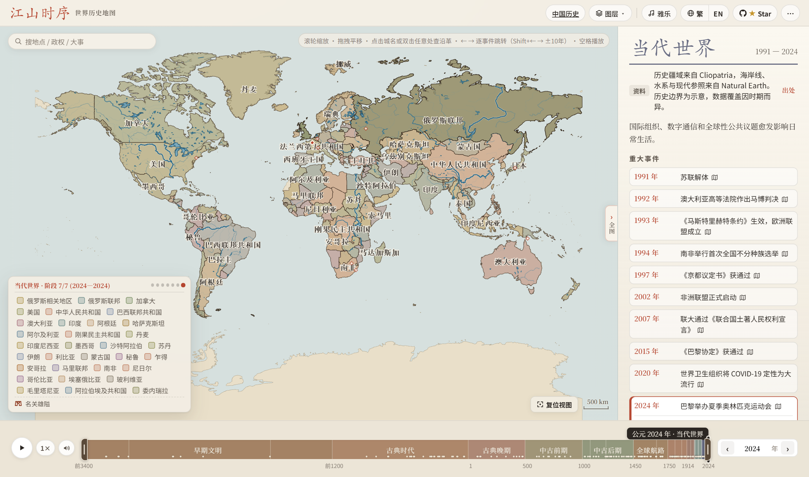
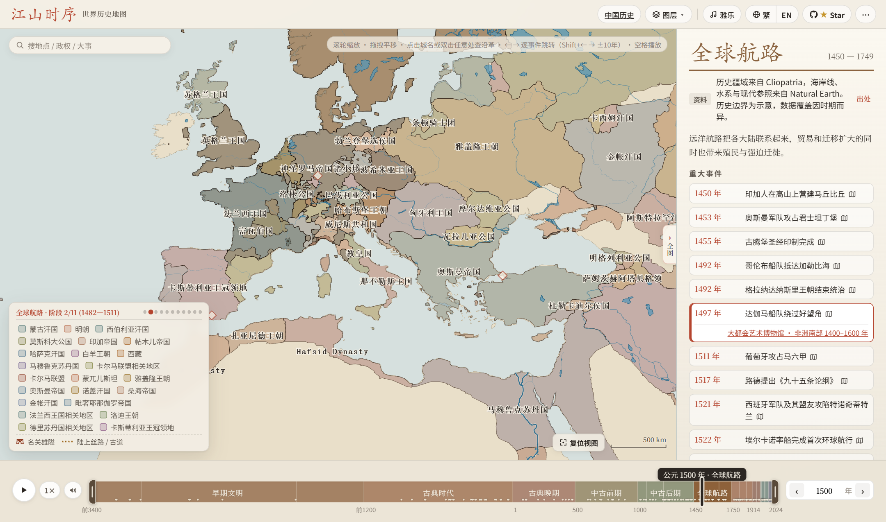

# 世界时序 · Jiangshan World Atlas

> **原项目** [江山时序（DeanChensj/jiangshan-map）](https://github.com/DeanChensj/jiangshan-map) · [原版在线地图](https://deanchen.me/jiangshan-map/)

一幅可在中国历史与世界历史之间切换的交互地图。拖动时间轴查看不同年代的政权疆域，点击地点或事件查看沿革、摘要和出处。

[](assets/preview_world_2024.webp)

*2024 年世界全图。右侧可查阅大事和出处，下方时间轴可以回看不同年代。*

## 项目来源与致谢

世界版由 [huang16s](https://github.com/huang16s) 在上游提交 [`73eea12`](https://github.com/DeanChensj/jiangshan-map/commit/73eea126752b49d65b461db0bb40304fc85a396d) 的基础上二次开发。感谢 DeanChensj 和原项目贡献者开发中国历史地图，整理史料、地图数据和交互功能。原项目的署名、提交历史和许可证随仓库保留。

## 本版本新增内容

- **中国与世界历史切换。** 中国地图顶部可打开世界历史，世界页可切回中国历史。两页沿用同一套地图操作、时间轴、搜索和史志界面。
- **世界疆域地图。** 世界页覆盖公元前 3400 年至公元 2024 年，按选定年份加载历史疆域。全球底图提供海岸线、河流、湖泊和现代参考界线，支持地图缩放和政权详情。
- **世界大事年表。** 收录 177 条有出处的事件，涵盖九个地理区域。事件可按时间浏览，详情包含中文摘要、地点和资料链接。
- **政权中文名与搜索。** 收录 763 个政权译名，重点补充欧洲历史政权。可用中文译名或英文原名搜索，例如「威尼斯共和国」和 `Republic of Venice`。

[](assets/preview_world_1500_europe.webp)

*1500 年欧洲与地中海局部。放大后可以辨认密集的历史疆界和政权中文名。*

## 本地运行

```sh
git clone https://github.com/huang16s/jiangshan-map-world.git
cd jiangshan-map-world
python -m http.server 8000 --bind 127.0.0.1
```

打开 [中国历史](http://127.0.0.1:8000/) 或 [世界历史](http://127.0.0.1:8000/world/)。项目自带运行所需的地图和年表数据，用静态 HTTP 服务即可预览。使用方式和维护步骤见 [中国版指南](README_ZH.md)、[中国版英文指南](README_EN.md)及[世界版指南](world/README.md)。

## 数据来源与许可

| 内容 | 来源与使用条款 |
| --- | --- |
| 世界历史疆域 | James S. Bennett 等人的 [Cliopatria v0.2.1](https://github.com/Seshat-Global-History-Databank/cliopatria/tree/v0.2.1)，见 [数据论文](https://doi.org/10.1038/s41597-025-04516-9)。按 [CC BY 4.0](https://creativecommons.org/licenses/by/4.0/) 使用，几何已简化、舍入并按年代分片。 |
| 世界底图 | [Natural Earth v5.1.2](https://github.com/nvkelso/natural-earth-vector/tree/v5.1.2) 的 1:50m 陆地、河湖和现代参考界线，数据为[公有领域](https://www.naturalearthdata.com/about/terms-of-use/)。 |
| 世界大事与人物路线 | 依据 UNESCO、档案馆、博物馆、学术论文和国际组织资料整理。事件来源逐条记录在 [events.json](world/events.json)，路线出处见 [lore.js](world/lore.js)。引用的第三方资料依原发布方条款。 |
| 政权中文名 | 参考 [Wikidata](https://www.wikidata.org/wiki/Wikidata:Licensing) 的 CC0 标签与别名，以及[联合国中文国名](https://www.un.org/zh/about-us/member-states)。译名与原始政权名的对应关系见 [polity-names.json](world/polity-names.json)。 |
| 中国历史疆域、一级政区与史料 | 沿用原项目，其中政权轮廓以 [historical-basemaps](https://github.com/aourednik/historical-basemaps) 为起点，后参照史籍重绘。详见[中国版数据来源与授权](README_ZH.md#数据来源与授权)及[历史疆域来源说明](data/atlas/README.md)。 |
| 中国历史郡、州、府界 | 由 [CHGIS V6](https://chgis.fas.harvard.edu/data/chgis/v6/) 与 [Robert M. Hartwell China Historical GIS](https://chgis.fas.harvard.edu/data/hartwell/) 派生，适用原数据条款。上游明确标注为学术、非商业用途，禁止再分发。 |
| 中国现代省界 | 来自 [DataV GeoAtlas](https://help.aliyun.com/en/datav/datav-7-0/user-guide/datav-geoatlas-widgets/)，数据来自高德开放平台，适用来源方的使用条款。 |

代码与本仓库原创内容采用 **GNU GPL-3.0**，完整文本见 [LICENSE](LICENSE)。上游版权 © 2026 DeanChensj。世界历史扩展由 huang16s 维护，本版变更记录日期为 2026 年 11 月 21 日。第三方资料适用各自条款。历史边界是依据来源数据制作的示意，覆盖与精度随年代而异。

如发现年份、政权译名或史料出处需要修正，欢迎在 [Issues](https://github.com/huang16s/jiangshan-map-world/issues) 提交对应年份和可核对的资料链接。
